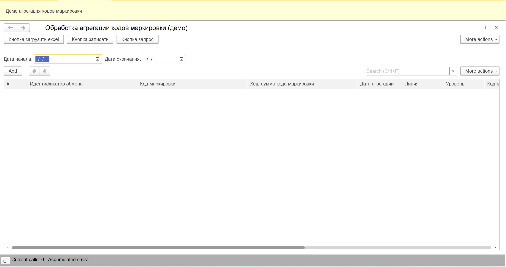
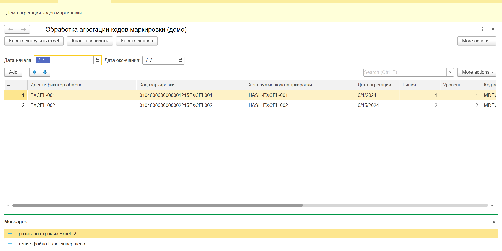
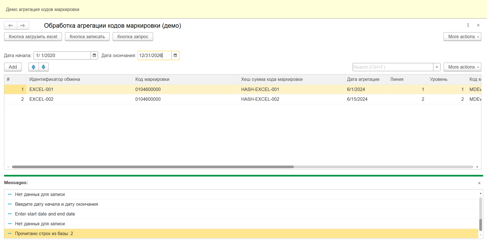

markdown
# Агрегация кодов маркировки / Marking Codes Aggregation

Внешняя обработка для 1С:Предприятие 8.3 — полный цикл работы с данными кодов маркировки.

External data processor for 1C:Enterprise 8.3 — full data cycle for marking codes.

---

## 📸 Скриншоты / Screenshots

### Главное окно / Main Window

### Загрузка из Excel / Loading from Excel

### Результат работы / Result

---

## 🇷🇺 Русский

### 🎯 Описание

Демонстрационный проект, показывающий полный цикл работы с данными на платформе 1С:Предприятие:

- **Запрос данных** из регистра сведений за указанный период
- **Загрузка данных** из файла Excel
- **Запись данных** в регистр сведений
- **Преобразование типов** (текст → дата, текст → число)
- **Обработка ошибок** при чтении файлов

### 💡 Назначение

Проект создан как демонстрация навыков разработки на платформе 1С:Предприятие 8.3.

### ✨ Ключевые особенности

| Особенность | Описание |
|-------------|----------|
| **Асинхронные вызовы** | `Асинх / Ждать` на клиенте |
| **Работа с файлами** | Чтение Excel через `ТабличныйДокумент` |
| **Наборы записей** | `НаборЗаписей.Записать(Истина)` |
| **Преобразование типов** | Текст → Дата, Текст → Число |
| **Обработка ошибок** | `Попытка / Исключение` |
| **Двуязычные комментарии** | Русский + Английский |

### 📋 Требования

- **1С:Предприятие 8.3** (платформа разработки)
- **Регистр сведений** `демо_АгрегацияКодовМаркировки`:

| Поле | Тип | Назначение |
|------|-----|------------|
| `КодМаркировки` | Строка(200) | Измерение (ключ) |
| `ИдентификаторОбмена` | Строка(100) | Измерение (ключ) |
| `ХешСуммаКодаМаркировки` | Строка(200) | Ресурс |
| `КодМаркировкиBase64` | Строка(500) | Ресурс |
| `КодАгрегации` | Строка(200) | Ресурс |
| `КодАгрегацииBase64` | Строка(500) | Ресурс |
| `ДатаАгрегации` | Дата | Реквизит |
| `Линия` | Число(2,0) | Реквизит |
| `Уровень` | Число(2,0) | Реквизит |

### 🚀 Использование

1. Открыть обработку `демо_ОбработкаАгрегацииКодов.epf`
2. Указать период (`Дата начала` — `Дата окончания`)
3. Нажать **Кнопка запрос** — загрузить данные из базы
4. Нажать **Кнопка загрузить excel** — загрузить данные из файла Excel
5. Нажать **Кнопка записать** — сохранить данные в регистр

### 📊 Структура файла Excel

Первая строка — заголовки (пропускается), данные со второй строки:

| № | Колонка |
|---|---------|
| 1 | Идентификатор обмена |
| 2 | Код маркировки |
| 3 | Хеш-сумма кода маркировки |
| 4 | Дата агрегации |
| 5 | Линия |
| 6 | Уровень |
| 7 | Код маркировки Base64 |
| 8 | Код агрегации |
| 9 | Код агрегации Base64 |

Пример файла: [`demo_excel_test.xlsx`](demo_excel_test.xlsx)

---

## 🇬🇧 English

### 🎯 Description

A demo project showcasing a complete data cycle on the 1C:Enterprise platform:

- **Query data** from an information register for a given period
- **Load data** from an Excel file
- **Write data** to an information register
- **Type conversion** (text → date, text → number)
- **Error handling** when reading files

### 💡 Purpose

The project is created as a demonstration of 1C:Enterprise 8.3 development skills.

### ✨ Key Features

| Feature | Description |
|---------|-------------|
| **Async calls** | `Async / Await` on the client |
| **File handling** | Reading Excel via `SpreadsheetDocument` |
| **Record sets** | `RecordSet.Write(True)` |
| **Type conversion** | Text → Date, Text → Number |
| **Error handling** | `Try / Except` |
| **Bilingual comments** | Russian + English |

### 📋 Requirements

- **1C:Enterprise 8.3** (development platform)
- **Information register** `демо_АгрегацияКодовМаркировки` (see structure above)

### 🚀 Usage

1. Open the processor `демо_ОбработкаАгрегацииКодов.epf`
2. Set the period (`Start date` — `End date`)
3. Click **Query** — load data from the database
4. Click **Load Excel** — load data from an Excel file
5. Click **Write** — save data to the register

---

## 📁 Структура проекта / Project Structure
.
├── README.md
├── LICENSE
├── .gitignore
├── demo_excel_test.xlsx # Пример файла Excel
├── демо_ОбработкаАгрегацииКодов.epf # Внешняя обработка
├── screenshot-main.png # Главное окно
├── screenshot-excel.png # Загрузка Excel
├── screenshot-messages.png # Результат
└── src/
└── Module.bsl # Исходный код модуля

text

---

## 🛠 Технологии / Technologies

| Технология | Применение |
|------------|------------|
| **1С:Предприятие 8.3** | Платформа разработки |
| **Язык запросов 1С** | Чтение данных из регистра |
| **ТабличныйДокумент** | Чтение файла Excel |
| **Асинх / Ждать** | Асинхронные вызовы |
| **НаборЗаписей** | Запись данных в регистр |
| **Попытка / Исключение** | Обработка ошибок |

---

## 🔮 Возможные улучшения / Possible Improvements

- [ ] Валидация данных перед записью
- [ ] Экспорт данных в Excel
- [ ] Поддержка CSV формата
- [ ] Юнит-тесты
- [ ] Поддержка больших файлов (потоковое чтение)

---

## 📝 Лицензия / License

MIT License — см. файл [LICENSE](LICENSE)

---

## 👤 Автор / Author

**Ghasson Shadi**

- GitHub: [@ghassonshadi5-tech](https://github.com/ghassonshadi5-tech)

---

## 🙏 Благодарности / Acknowledgments

Проект создан как демонстрация навыков разработки на платформе 1С:Предприятие.

Project created as a demonstration of 1C:Enterprise development skills.
